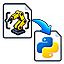

# KarelToPython



KarelToPython translates a supported subset of FANUC KAREL into Python for
offline inspection and execution. The current build is **26.1124.195011**.

## Table of Contents

- [Background](#background)
- [Install](#install)
- [Usage](#usage)
- [Supported Features](#supported-features)
- [Development](#development)
- [Maintainers](#maintainers)
- [Contributing](#contributing)
- [License](#license)

## Background

The translator checks KAREL types, storage, and control flow before generating
Python. The offline runtime models variables, I/O, files, and other services
using supplied data. See the [language support guide](docs/language-support.md)
and [remaining support inventory](docs/unsupported.md).

## Install

Requires **Python 3.11 or later**. The desktop workbench also requires Tkinter.
From a virtual environment:

```sh
git clone https://github.com/votecoffee/KarelToPython.git
cd KarelToPython
python -m pip install .
```

## Usage

### CLI

Validate, translate, and run the sample. The final snapshot has `TOTAL=200`.

```sh
python -m karel2py examples/control_flow.kl --check
python -m karel2py examples/control_flow.kl -o converted.py
python converted.py
```

Add `--report translation.json` to save diagnostics and the source map. The CLI
requires new output paths by default. Use `--force` to replace selected outputs
and `--version` to check the installed build. For linked sources, see the
[project CLI](docs/portable-projects.md).

### Desktop GUI

```sh
python -m karel2py.gui
```

Open KAREL, choose **Translate to Python**, then **Save Python**. Choose
**Run Python**, then **New from Python** to select the generated file and
create a saved run. Select a discovered input and choose **Edit value** or
**Edit fields**. Use **Edit context** to configure services. **Run** executes
the saved inputs, and **Last result** shows termination status and saved state.
**WRITE output** shows the captured text. Choose **New linked** to pin several
cooperative Python modules, select an entry program, and edit discovered inputs
by owner and path. Choose **Prepare inputs** to add editable inputs to an
existing linked run. Choose **Revise linked** to carry compatible inputs to a
new module set.
See the [desktop guide](docs/desktop.md).

### Python

```python
from karel2py import translate

result = translate("PROGRAM DEMO VAR n:INTEGER BEGIN n=6*7 END DEMO")
print(result.python_source)
```

See the [API guide](docs/api.md) for generated Program instances, context
providers, execution limits, and linked projects.

### Saved runs from the CLI

```sh
python -m karel2py.runner create converted.py session.run.json --discover
python -m karel2py.runner run session.run.json
```

Edit `inputs.context` before running a program that requires initial values.
Discovered inputs include caller-local TP registers, grouped TP program
positions, position comments and writable TP headers. Discovery follows bounded
choices for TP programs, handles and bank addresses, including reads across
child pause handoffs in entry programs and synchronous routines. Known
branches, bounded loops, and routine calls can pause and resume across a
pinned task wait. Discovery keeps scalar and ordinary aggregate routine
arguments across pauses, including private copies and references. Ordinary
aggregate results can feed another call, console `WRITE`, an assignment, or a
field or array selection. Discovery follows checked data schema conversions
across those calls and assignments. It preserves evaluation order in built-in
arguments, `ARRAY_LEN` selectors, and loop bounds and tests. Integral PATH
header and node fields can serve as counters across pauses. `USING` retains
borrowed and private data records, including PATH headers and nodes. A direct
PATH selector binds the record, and a forwarded whole-record formal keeps its
slot. Scalar `UNINIT` follows pausing field selectors without reading a missing
value. Pythonic `EVAL` snapshots PATH and queue contents in `WAIT FOR` and
`REPEAT UNTIL`. It also captures live FILE descriptors, banks, and selected
rows. Linked discovery follows these `REPEAT` captures across pauses and
iterations when it can track the FILE state in memory.
Linked discovery also follows edits and copies of queues initialized in the
source or restored from the saved run context. PATH and queue arguments
keep their borrowed cells or private values across pauses in pinned routines.
Whole PATH record parameters retain their slots, and field parameters keep
their selected records through known edits. PATH assignment and same-schema
`COPY_PATH` retain their operands across pauses. PATH and queue results, including banks, can feed assignments,
routine calls, selectors, and output.
Console `WRITE` follows pausing PATH and queue selectors and PATH range bounds.
Direct subscripts retain a PATH already selected before a pausing index.
The analyzer also preserves captured records and entries while format
routines run.
Linked discovery also follows text and binary `READ` and `WRITE` on memory files. It
tracks predefined routes and source-declared FILE cells through attributes,
open, seek, availability queries, idle cancellation, close, and reopen.
Direct FILE arguments retain their original descriptors across calls to pinned
routines. Reads retain selected destinations across pauses, including PATH
headers, nodes, ranges, and bank selections. Discovery checks CONFIG turn
limits and whole POSITION orientation before publishing any field or cursor
facts. Reads also cover existing entries in initialized queues and queue banks.
Discovery retains modified byte ranges so bounded reads can use known
bytes in large files. `COPY_FILE`, `RENAME_FILE`, and `DELETE_FILE`
track exact names and wildcard batches on in-memory files across pauses.
Copied or renamed saved files retain their original input address.
Input discovery also tracks the status and handle for each possible TP open
outcome. Inputs and results share one JSON file.
Use `runner refresh` to carry compatible inputs to a new translation.
See [saved runs](docs/run-documents.md) and [input discovery](docs/input-discovery.md).
For multiple linked modules, export cooperative Python and pin the set with
`runner create-project --discover`. Use `runner prepare-project` to add or update
a saved linked run's input template and `runner refresh-project` to carry
compatible saved inputs into a new linked document. Discovery includes possible
reads from known child tasks, supported task continuations, numbered handlers,
and local motion callbacks. Uncertain activation and scheduling stay visible in the
report.
See [linked project runs](docs/run-documents.md#linked-project-runs).

## Supported Features

- Structured control flow, labels and jumps, routines, and reference parameters.
- Checked scalar types, arrays and records, and common math and string builtins.
- Fixed and slot-bound [dynamic ARRAY allocation](docs/dynamic-fixed-arrays.md).
- Offline registers, ports, files, PATH and queues, task control, and timers.
- Position and joint operations with explicit models for kinematics.

Pythonic mode uses practical Python numeric behavior. The [feature guide](docs/feature-guide.md)
covers translation options, offline services, and the detailed feature history.
See the [roadmap](docs/roadmap.md) for the compiler decomposition, remaining
linked runner work, and the future strict mode.

## Development

Install with `python -m pip install -e .`. Run focused tests near each change.
The full local checks cover unit tests, 609 standalone examples, and 250 linked
projects:

```sh
python -m unittest discover -s tests
python tools/run_examples.py
python tools/check_repository.py
```

Native GUI checks are opt-in. GitHub Actions workflows run by manual dispatch.
See the [developer tools](tools/README.md), [compiler architecture](docs/compiler-architecture.md),
and [changelog](CHANGELOG.md). Keep private research and generated artifacts
outside tracked source or in `.local/`.

## Maintainers

[@votecoffee](https://github.com/votecoffee).

## Contributing

Questions and bug reports are welcome in
[GitHub issues](https://github.com/votecoffee/KarelToPython/issues).
Pull requests are welcome. Include a small authored reproducer and meaningful
tests for changed behavior; keep unresolved semantics explicit and exclude
private or proprietary inputs. See [CONTRIBUTING.md](CONTRIBUTING.md).

## License

[MIT](LICENSE) © 2026 votecoffee.
